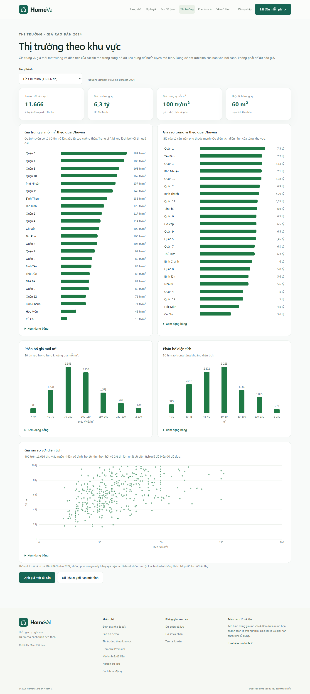
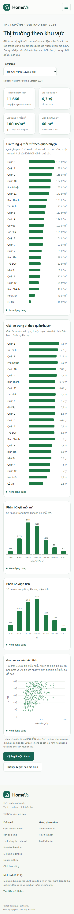
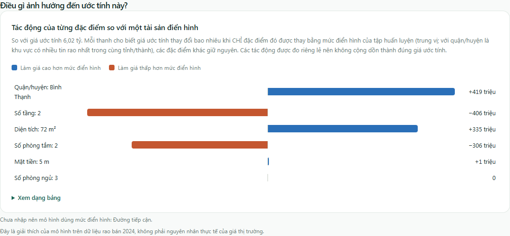
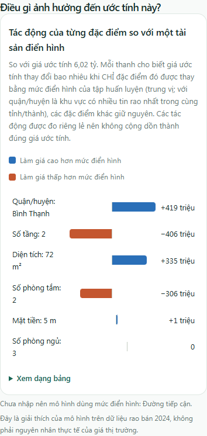
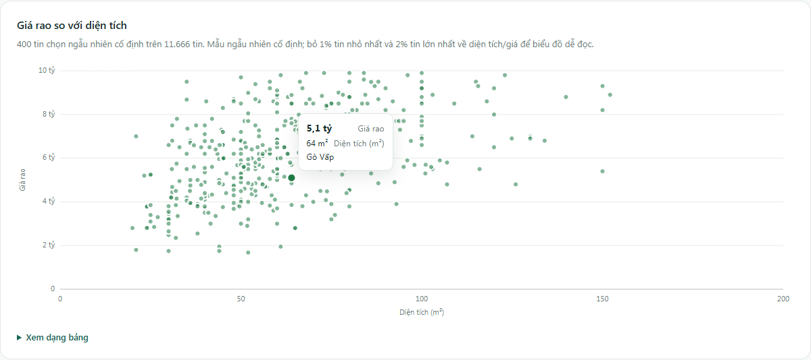
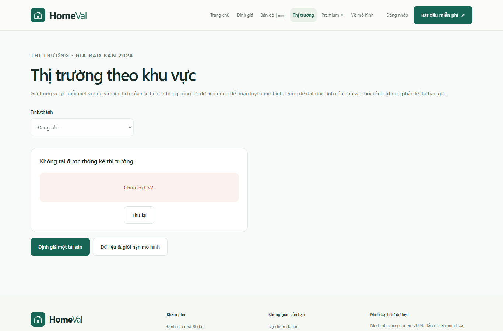
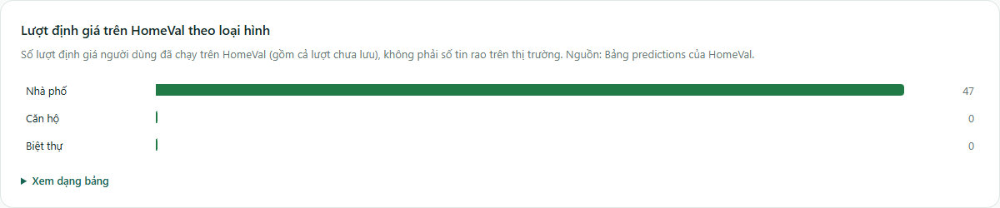

# FE-06: Market Insights and estimate explanation

Covers GU-6 (#33), GU-4 (#32) and the reusable chart block from FE-06 (#3).

## What was added

| Screen | Route | Data |
| --- | --- | --- |
| Market Insights | `insights.html?city=…` (header: **Thị trường**) | `GET /api/insights?city=` (public) |
| Estimate explanation | `predict-result.html`, `detail.html?id=…` | `explanation` in `POST /api/predictions`, stored with saved predictions |

### `/api/insights`
Descriptive statistics of the same cleaned Vietnam Housing Dataset 2024 used for training:
city list (cities with ≥ 30 listings), summary medians, per-district median price, price per m² and area
(districts with ≥ 30 listings), price-per-m² and area histograms, and a fixed random sample of 400
listings for price vs. area (1st–98th percentile view, disclosed in the response). The dataset has no
property-type column, so a house-type breakdown is **not** shown; the page says so instead of inventing it.

### Property types: `/api/insights/property-types`
The dataset has no type column, so the page does **not** split market data by type. Instead the last chart
counts the estimates people ran on HomeVal per type (Nhà phố / Căn hộ / Biệt thự), straight from the
`predictions` table with one SQL `GROUP BY` on the JSON input (`JSON_EXTRACT` on SQLite, `->>` on Postgres),
plus how many were saved. Aggregates only; it is labelled as HomeVal usage, not market listings, and it loads
independently so its failure never hides the market charts.

### Estimate explanation
Model-agnostic, one-at-a-time explanation: for each input the user provided, the model is re-run with only
that input reset to the training median (district: the city's most common district). The bar is the
difference in the estimate. Effects are measured separately and do not add up to the price; the page says
this. Inputs the user left empty are listed as "using the typical value". Saved records from before this
change show an explicit message instead of a chart.

## Chart block: `frontend/js/charts.js`
`barChart`, `divergingBarChart`, `histogram`, `scatterChart`, `chartLoading`, `chartError`.
Each takes a data object and returns a `<figure>` (no DOM ids), with title/description wired for screen
readers, a hover **and** keyboard-focus tooltip, a "Xem dạng bảng" table with every value, and explicit
empty / invalid-data states. Styles: `frontend/css/charts.css`.

Palette (checked with the dataviz six-check method on the white card surface, light mode only like the site):

| Role | Colour | Check |
| --- | --- | --- |
| Single series | `#1f7a45` | L 0.514, C 0.118, contrast 5.35:1 |
| Raises estimate | `#2a6fb8` | L 0.536, C 0.134, contrast 5.17:1 |
| Lowers estimate | `#c4562f` | L 0.587, C 0.151, contrast 4.45:1 |
| Raises ↔ lowers | | CVD ΔE 20.6, normal-vision ΔE 27.7 |

Sign is never colour-only: values carry `+`/`−`, and a legend is always shown.

## Verification
- `python -m pytest backend/tests -q` → explanation shape/sorting/consistency, saved-record round trip,
  insights totals, sorting, city switch, unknown city 404, over-long city 422.
- Edge (Playwright) at 1366 px and 390 px: no horizontal overflow, no console errors; tooltip on hover/focus;
  city switch updates URL; unknown `?city=` falls back with a notice; API failure shows retry.
- Mock mode (`USE_MOCK = true`, every `/api/*` request blocked): Insights and the result explanation render
  from `frontend/mock/` with zero API calls.

| Desktop | Mobile |
| --- | --- |
|  |  |
|  |  |

 

