# UI-1: "Bản vẽ" theme (drawing sheet)

A visual system modelled on how architecture studios present work, applied to every HomeVal screen.
Page structure, JS hooks and API calls are unchanged.

## Why v2
The first version (ivory + italic serif + bronze accent + spaced capitals) is the most common generated
"luxury" template and read as such. Architecture sites studied for v2 (Koozarch, Cargo architecture
portfolios, Smout Allen, Yellow Office, Socks Studio) share the opposite habits: one grotesk at modest
sizes in sentence case, hairline rules instead of cards, no rounded corners or shadows, numbered indexes,
annotations in the corners of images, and colour coming from photographs only.

## Design decisions
| | Choice | Reason |
| --- | --- | --- |
| Type | **Familjen Grotesk** for everything, **IBM Plex Mono** for annotations | Both ship Vietnamese glyphs (checked in the Google Fonts CSS); Familjen has more character than the usual Inter/Geist; mono labels read like drawing annotations. Offline fallback: Helvetica Neue / Arial. |
| Colour | Plaster `#f3f1ed`, ink `#141414`, grey `#67635d`, one accent: cyanotype blue `#2a48c4` | Warm white rather than cream; blue is the colour of a blueprint. Contrast 16.3 / 5.3 / 6.6 : 1. |
| Shape | No radius anywhere, 1 px rules, no shadows | Drawing sheet. |
| Photography | Full-bleed; **half of the frame out of focus (white text), half sharp** | The "nửa mờ nửa rõ" motif, done on the photo itself instead of a panel on top. |

## Files
| File | Role |
| --- | --- |
| `frontend/css/luxe.css` | Loaded **last** on every page; tokens, type, header, buttons, forms, rules, charts, page heroes and the Home sections. |
| `frontend/css/luxe-remap.css` | **Generated** by `python scripts/build_luxe_remap.py`: 321 green colours hard-coded in the legacy stylesheets become near-neutral greys with the same selectors and lightness. No legacy CSS file is edited, so open PRs still merge. |
| `frontend/js/luxe.js` | Home-only: hero photos follow the existing `home.js` slider; autoplay 7 s with pause, paused on hover/focus/hidden tab, off with reduced motion; index hover/focus swaps the preview photo; scroll reveal; drag/arrow-key gallery. |
| `frontend/credits.html`, `frontend/img/photos/credits.json` | Author, licence, source and changes for every photograph. |

`home.js` changes by one line (the swipe target); PR #97 merges cleanly on top.

## Home, top to bottom
Hero with title-block metadata in the corners (dataset, coordinates of Ho Chi Minh City, slide caption) ·
quick estimate as a ruled form row · (i)(ii)(iii) value strip · (01) studio-style statement ·
(02) numbered index of the six areas of the product, preview photo follows the hovered row ·
real figures (29.899 listings, 26 provinces, 3 models, 90% target interval) · (03) swipe gallery ·
(04) Premium photo band · process, FAQ · (05) closing photo band.

## Photographs and licences
Nine photographs from **Wikimedia Commons**, licence read from the Commons API at download time:
1 × CC0, 7 × CC BY 2.0, 1 × CC BY 4.0. `credits.html` names author, licence link and changes
(resized, warm colour grade) for each. Labelled as illustrations, not listings. No Pinterest images
(pins are mostly other people's copyrighted photographs).

## Checks
- Edge at 1366 px and 390 px on 9 pages: no horizontal overflow, broken images, HTTP 4xx or console errors.
- Computed-style scan of 19 pages (guest / user / admin): no leftover green except the success status badge.
- Motion: advances at 7 s, pause and hover stop it, next/prev/keys work, reduced motion disables it;
  index preview follows hover and keyboard focus; gallery moves one photo per click.
- Charts re-validated on paper `#fbfaf8`: single series `#2a48c4` (L .463, C .196, 6.6:1);
  up/down `#2a48c4` / `#b8572e` (CVD ΔE 26.2, normal ΔE 32.6).

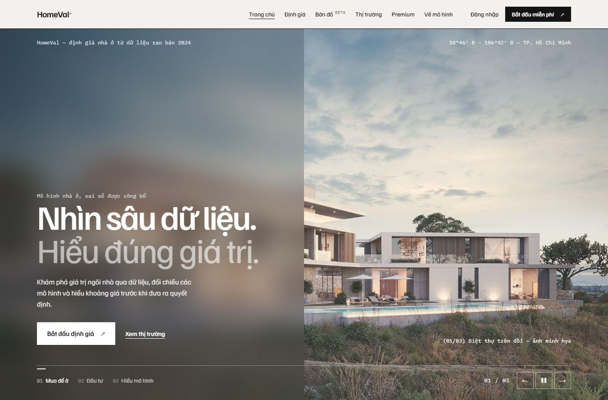

| Before | After |
| --- | --- |
| 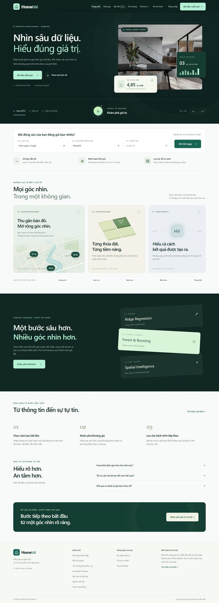 | 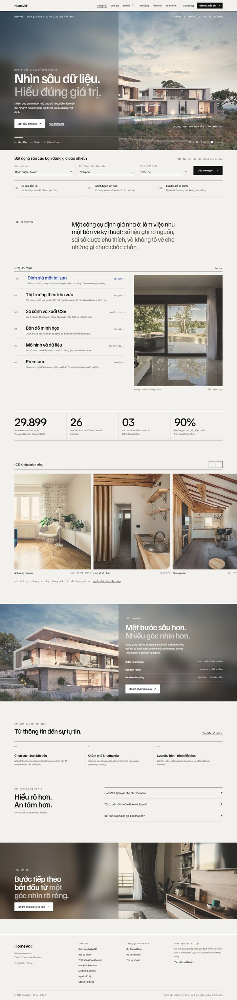 |

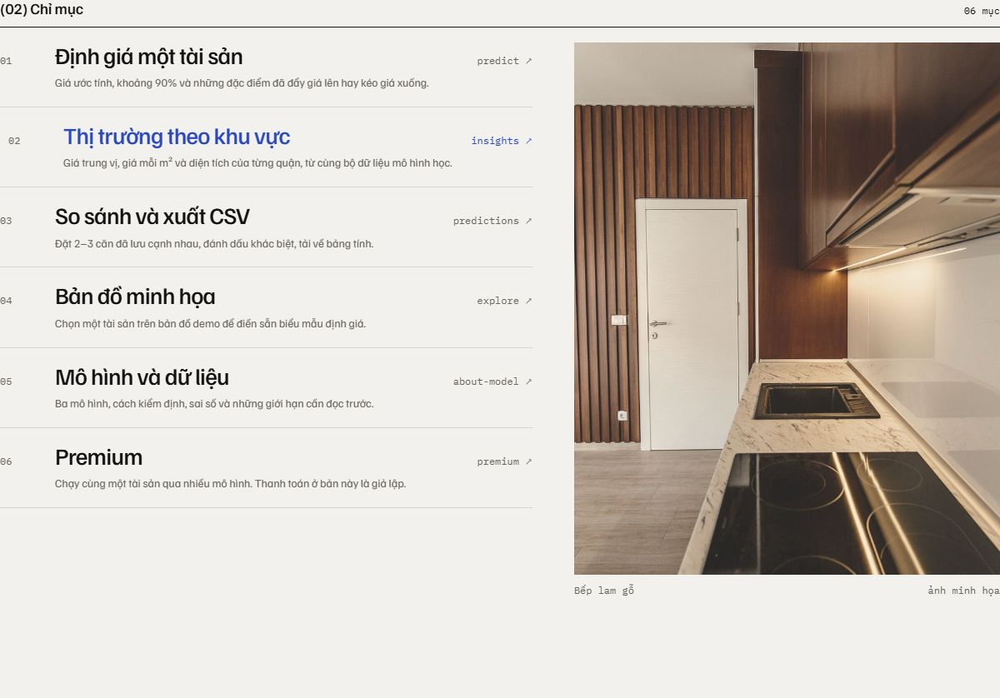

| About | Premium | Insights |
| --- | --- | --- |
| 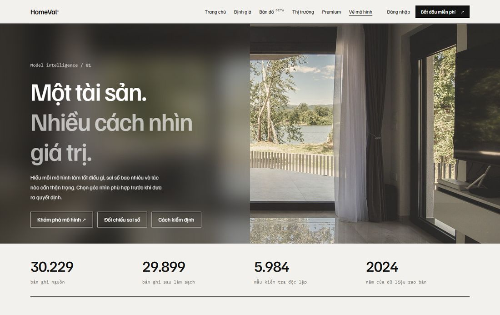 | 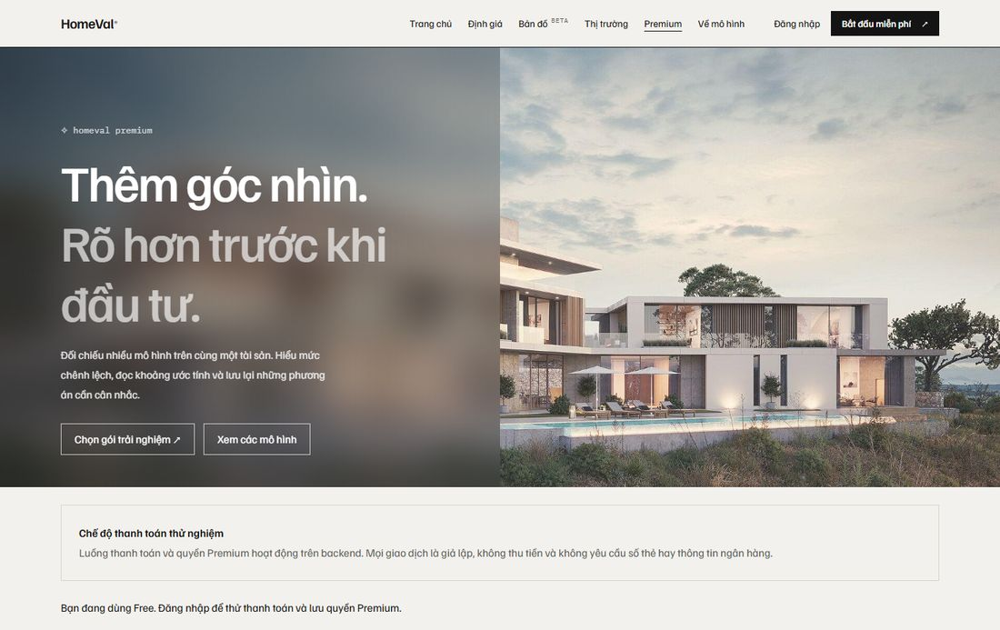 | 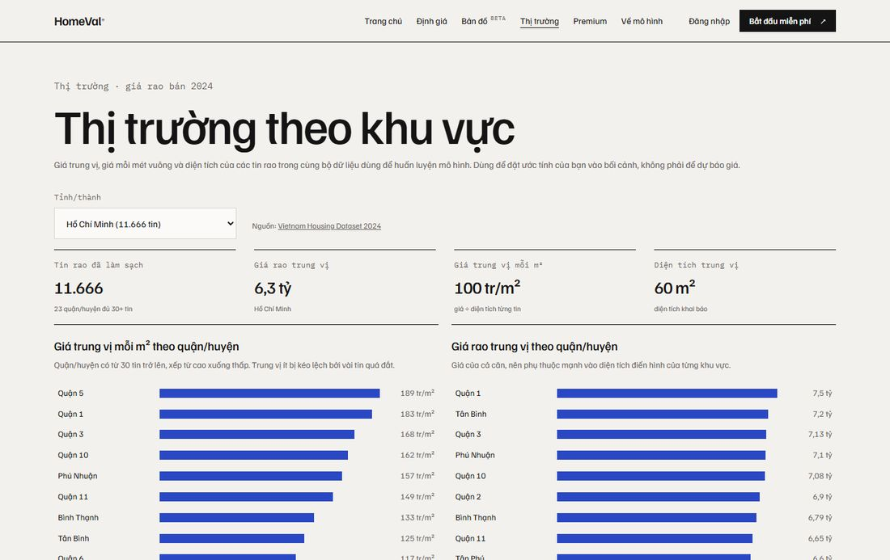 |
| 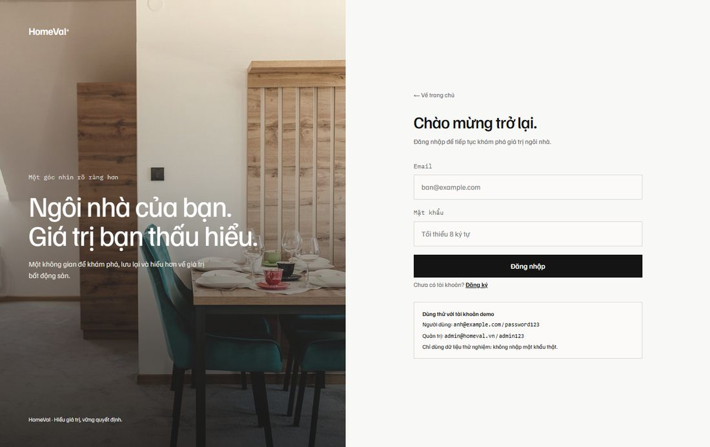 | 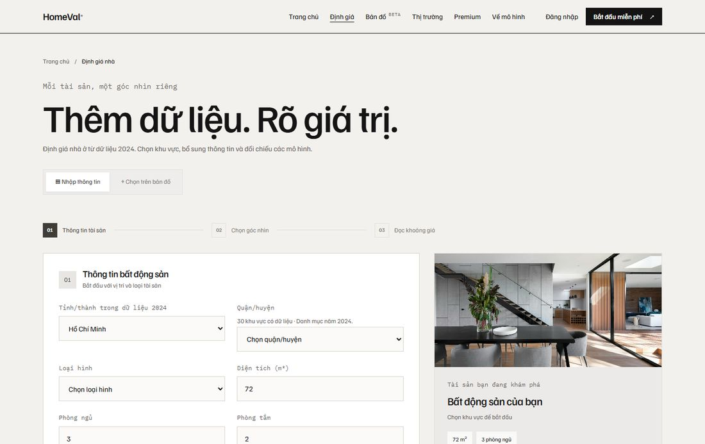 | 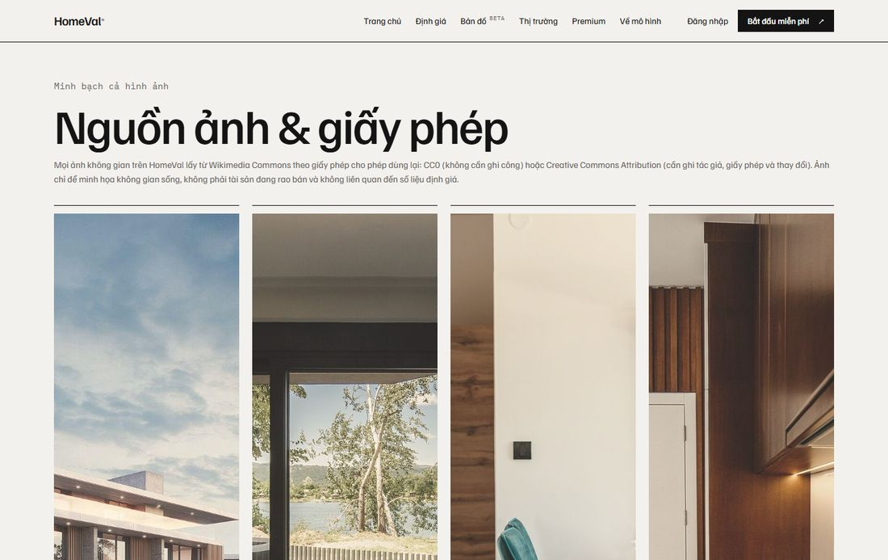 |

| Mobile home | Mobile about |
| --- | --- |
| 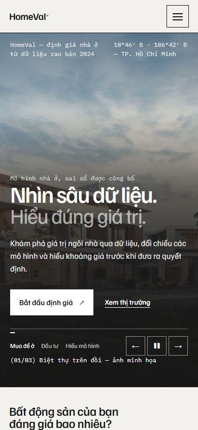 | 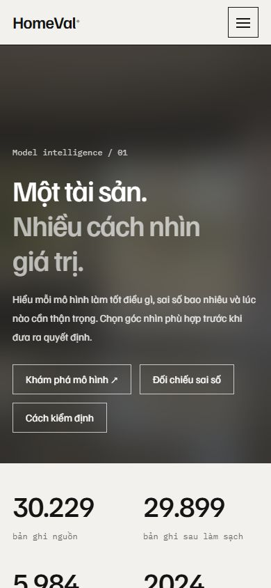 |
