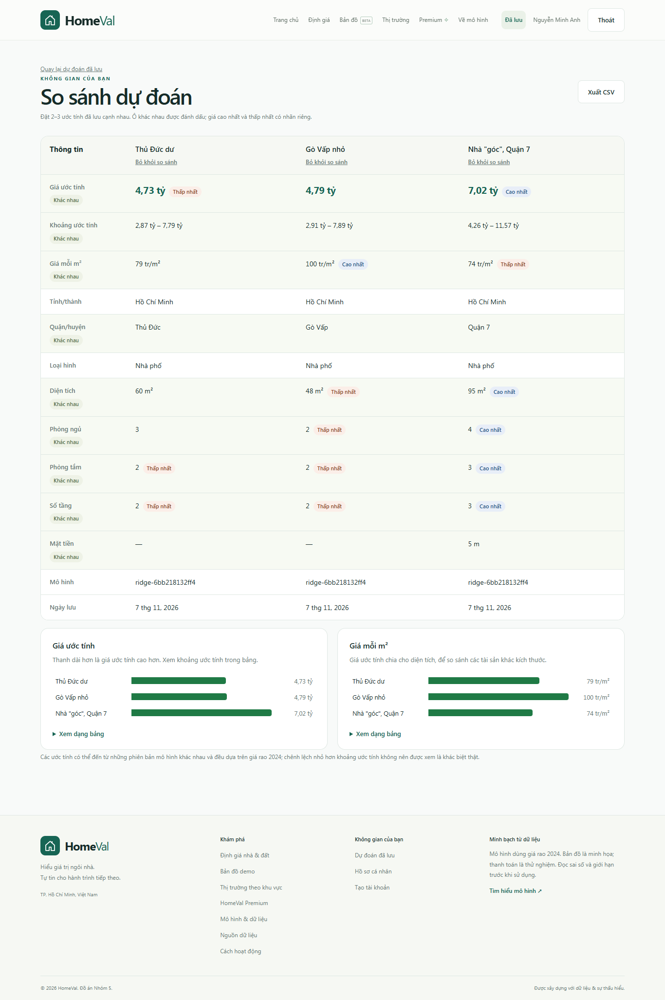
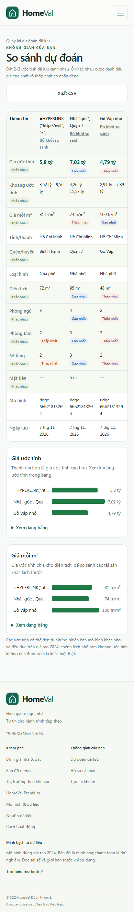
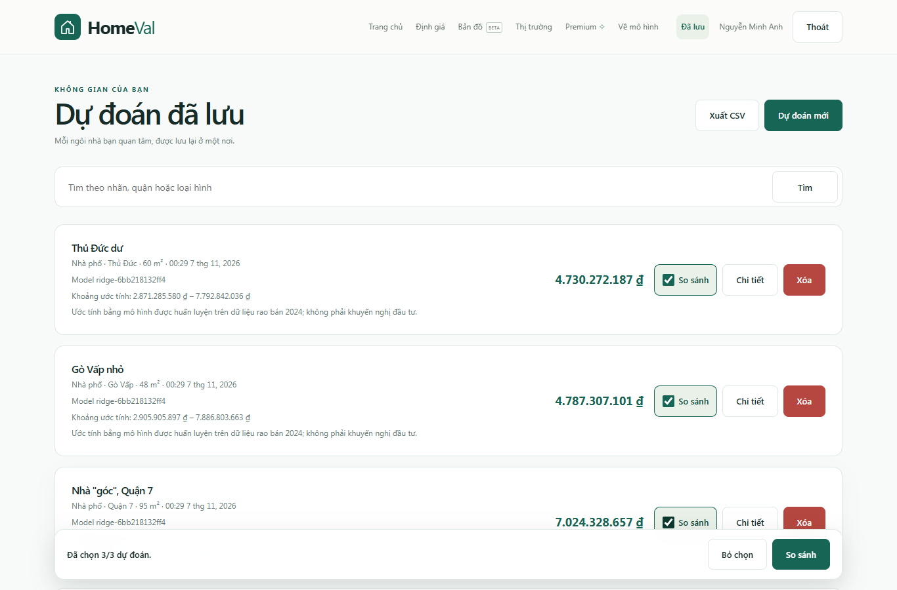
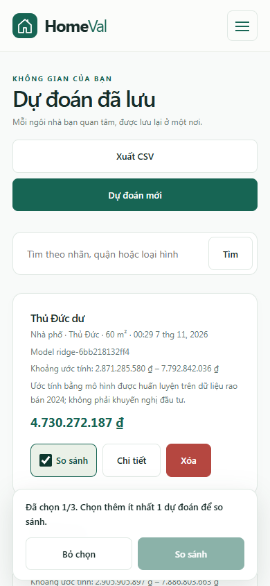

# US-7 compare and US-8 CSV export

## US-7 (#36): compare 2–3 saved estimates
- **Entry:** `predictions.html`. Tick **So sánh** on 2 or 3 rows, then use the sticky bar → `compare.html?ids=a,b,c`.
  At 3 the other checkboxes are disabled; the choice survives search/reload (sessionStorage).
- **Compare page:** one column per estimate (link to detail, "Bỏ khỏi so sánh"), rows for price, interval,
  price per m², location, type, area, rooms, floors, frontage, road, model and date. Rows that differ get a
  tint **and** a "Khác nhau" badge; numeric rows label **Cao nhất / Thấp nhất**. Two bar charts (price,
  price per m²) from the shared chart block. Rows nobody filled in are omitted.
- **States:** not signed in → login and back; fewer than 2 ids → empty state with a link to the list;
  more than 3 → first 3 plus a notice; deleted / other users' ids → skipped with a notice; API failure →
  error with retry.

## US-8 (#49): CSV export
- `predictions.html` → **Xuất CSV**: the whole history (all pages, ignoring the search box).
- `detail.html` → **Xuất CSV**: that one prediction. `compare.html` → **Xuất CSV**: the compared estimates.
- One schema (`frontend/js/csv.js` `PREDICTION_COLUMNS`, 20 columns): inputs, raw VND prices, interval,
  confidence level, price per m², model, disclaimer. RFC 4180 quoting, CRLF, UTF-8 BOM for Excel.
- **CSV injection guard:** text cells starting with `= + - @`, tab or CR are prefixed with `'`
  (user labels are untrusted).
- Generated in the browser from data the page already has, so it works the same with `USE_MOCK`.

## Also fixed
`auth.js` deleted the `mock-token` session on every page load even when `USE_MOCK = true`, which made every
signed-in screen impossible to demo without the backend. The clean-up now only runs in live mode.

## Verification
Edge via Playwright against the live backend (isolated DB copy), plus mock mode with every `/api/*` blocked:

- selection limit, sticky bar text, disabled 4th checkbox, selection synced back from the compare page;
- history CSV has BOM, 20 columns, all rows; label `=HYPERLINK("http://evil","x")` exported as `'=HYPERLINK…`;
  label `Nhà "góc", Quận 7` round-trips through a CSV parser unchanged;
- compare: badges, charts, remove-one, missing id, >3 ids, no ids, HTTP 500 retry, guest redirect;
- 1366 px and 390 px: no page overflow; the table fits 3 columns on a phone; 0 console errors;
- mock mode: login → history → compare → CSV with 0 API calls;
- `node` unit check of `toCsv` (formula guard, quotes, newlines, null/NaN).

| Desktop | Mobile |
| --- | --- |
|  |  |
|  |  |
